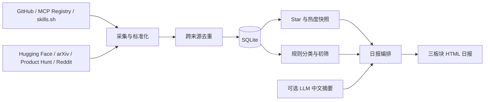

<div align="center">

# 🛰️ Agent Radar

### 让热门 AI 项目、可用工具与数据智能前沿，每周三次汇成中文情报

**Python 3.11+ · SQLite · 单文件 HTML 日报 · GitHub Actions · 无必装第三方依赖**

</div>

> 一个从真实问题出发、用 Vibe Coding 做成的 AI 技术情报 Agent。

[项目故事](#为什么做这个项目) · [搜索策略](#它怎样寻找值得看的内容) · [效果预览](#效果预览) · [本地运行](#快速本地运行) · [定时运行](#每周定时运行github-actions)

## 为什么做这个项目

每天都有人发布新的 Agent、MCP、Skill、开源软件和论文。刷 GitHub Trending，能看到 Star 很高的项目，却很难快速知道**它到底是做什么的、和自己有没有关系、能不能拿来用**。看社区推荐，又容易被单一圈子的热门话题带着走；今天看到一个惊艳的工具，过几天就找不到了。

我希望有一个替我持续观察的助手。它需要帮我看见三种东西：第一，AI 世界最近有哪些真正受到关注的项目，它们分别解决什么问题；第二，像 [REA](https://github.com/morluto/rea) 这样的开源工具，有哪些值得我下载或接入自己的工作流；第三，Data Agent、企业数据分析和 Text-to-SQL 方向，谁发布了新产品或论文，论文声称的效果提升到底拿什么作对比。

**Agent Radar 就是这个助手的第一版。** 它在每周一、周三和周六从多个公开来源采集线索，保存到自己的数据库，再生成一份可以离线打开的中文报告。你不需要逐个网站搜索，也不需要在一堆英文项目简介里猜用途。先读报告，发现感兴趣的项目，再点开原始来源核对和试用。

这个项目的目标是**打开视野，并减少从“看到名字”到“决定是否深入了解”的时间**。日报保留原始链接、采集日期和可核对的热度与反馈线索；它不会把 Star 当成质量证明，也不会把论文摘要中的自述当成已经确认的突破。

## 它每次运行交付什么

Agent Radar 回答三个问题：

| 日报板块 | 我想知道什么 | 展示内容 |
| --- | --- | --- |
| **01 · 看见趋势** | 现在热门的 AI 项目都在做什么？ | 按平台热度排列的项目、中文用途介绍、分类、热度和快照增长 |
| **02 · 亲自试试** | 哪些工具可以拿来用？ | 开源仓库、MCP、Skill 或在线应用，以及安装与公开反馈线索 |
| **03 · 数据智能前沿** | Data Agent 和企业数据分析有了什么新进展？ | 独立的数据项目席位，以及 Text-to-SQL 等方向的论文与评测线索 |

日报是一个可以直接在浏览器打开的 HTML 文件，支持按名称、项目分类和行业筛选。每个入选项目都有简要中文介绍。近期候选不足时，系统会从已保存的相关内容中补充，并标明最近采集日期；历史内容不会被伪装成今日新发现。

## 它怎样寻找值得看的内容

我不希望只依赖一张“AI Agent 关键词表”。项目既要能发现新热点，也要能持续跟踪已经知道的好东西。因此搜索分为三条互补的路线：

| 路线 | 实际做法 | 想解决的问题 |
| --- | --- | --- |
| **宽口径发现** | GitHub 用 `topic:artificial-intelligence`、`text-to-sql in:name,description`、`"data agent" in:name,description` 等查询，按 Star 从高到低取样 | 避免日报只出现 MCP 或 Agent 增强项目，看到更广的 AI 与数据方向 |
| **主题增量追踪** | 对 MCP Server、Model Context Protocol、Agent Skill、AI Agent 等查询追加 `stars:>=100` 与 `pushed:>=日期`，按最近更新采集 | 每次运行发现仍在活动、达到基本关注门槛的新候选 |
| **精确观察列表** | 通过 `github_watchlist` 直接请求指定仓库；默认包含 `morluto/rea` | 关键词搜索漏掉一个值得关注的项目时，仍能持续观察它 |

GitHub 之外还并行观察：MCP Registry 的增量目录；Hugging Face Spaces 的趋势应用；arXiv 上近期的 Text-to-SQL 与 Data Agent 论文，失败时尝试 Hugging Face Papers；Product Hunt 的新品；有有效令牌时的 skills.sh 热门 Skill；以及可访问时的 Reddit 社区讨论。**Product Hunt 与 Reddit 是发现线索，不会直接伪装成已验证可部署的 GitHub 项目。** 各来源的权限与目前限制见[数据源与访问条件](#数据源与访问条件)。

### 一条线索怎样进入日报

1. **先保存证据。** 采集器把名称、描述、来源链接、公开热度和采集时间写进 SQLite；相同 GitHub 仓库尽量合并，Star 和其他指标按天留快照。
2. **执行门槛。** GitHub 仓库默认至少 100 Stars。关联 GitHub 的 MCP 项目若未验证达到门槛，也不会因为登记在目录里就自动获得推荐。论文没有 Star 门槛，而是按主题和发布日期筛选。
3. **判断“是做什么的”。** 根据项目标题、简介、类型和主题词归入 Agent 增强、独立 Agent、AI 编程、数据分析、创作设计、工作流、模型基础设施等类别，并给出简短中文用途。标题信息优先，避免描述里提到 Claude 就把所有工具归为 Agent 增强。
4. **再安排三个板块。** 热门栏优先展示最近 7 天采集到的项目，并按**来源指标的当前数值**排序；可用工具栏筛选有工具或应用线索的项目，单个类别最多先占 3 席；数据栏独立筛出数据分析项目与相关论文。近期内容不足时，从历史收录补位并标明日期。
5. **把热度和“可用性”分开说。** 有 30 天前后的同指标快照才显示增长；GitHub 可抽查 README 的安装说明、近期 Issue 与评论，标注公开反馈。没有完成抽查时就写“待核查”。

推荐分析同时保留四个维度：**项目用途**（它解决什么问题）、**面向行业**（生活、数据产品、音乐等）、**热度与增长**（当前关注量与可用的 30 天快照）、**获取与部署线索**（代码、安装入口、公开运行反馈）。内部推荐分会综合这些维度，给生活、数据产品和音乐较高的行业权重；但热门板块的实际排列仍先看平台热度，推荐分只用于同热度时的辅助排序。这样既能先看到“现在大家在关注什么”，也能从另外两个板块找到更贴近个人需求的项目。

这一版的“热门”指**项目在来源平台的当前关注量**，不等于全网统一热度排名。GitHub Stars、Skill 安装量和 Spaces Likes 不能直接比较；30 天增长也需要持续运行后才会出现。宽口径 GitHub 搜索有返回条数上限，因此这是一个有明确覆盖边界的雷达，而不是全网爬虫。

## 作品亮点

- **从发现到阅读的一条完整流水线**：采集 → 去重 → SQLite 入库 → 热度快照 → 规则分析 → 可选 LLM 摘要 → HTML 日报。
- **热度优先，保留多样性**：热门板块按各来源的当前热度排序；可用工具板块限制单一类别占满版面；数据研究有独立席位。
- **GitHub 至少 100 Stars**：默认只将达到门槛的 GitHub 仓库放进推荐。其他平台使用各自的安装量、Likes、Votes 等指标，并明确标注来源。
- **把“能否用”拆成可核对的证据**：公开代码、安装资料与近期 Issue/评论抽样。没有抽查结果时显示“反馈待核查”，不会声称已在用户电脑上跑通。
- **论文与项目分开看**：论文卡片保留发布日期、摘要和可提取的评测对比；只有找到可核对的基线、数据集和指标，才展示相应比较。
- **可持续积累的观察**：数据库保存增量采集状态及指标快照。30 天增长必须有足够久的历史快照，不会从当前总量倒推。
- **降级运行**：某个来源失败时，其他来源继续采集；已保存的数据仍可重新生成报告。

## 效果预览

```text
每日技术情报                                      2026-10-17
├─ 01 热门 AI 项目在做什么       热度、中文简介、30 天增长
├─ 02 哪些工具可以拿来用         获取方式、部署线索、公开反馈
└─ 03 数据 Agent 与企业分析前沿  开源项目 + 论文与评测

搜索项目  [ 全部类别 ▼ ]  [ 全部行业 ▼ ]
```

本仓库运行后会生成 `reports/YYYY-MM-DD.html`。直接双击即可离线阅读；无需启动 Web 服务。Product Hunt 新品与 Reddit 社区线索放在第一个板块内，来源覆盖与采集错误显示在页尾。

**[示例日报文件](docs/sample-report.html)** 随仓库保存。下载后用浏览器打开即可查看完整排版；定时运行生成的报告位于 `reports/`。

## 快速本地运行

**准备：** Python 3.11 或更新版本。项目只用 Python 标准库，无需 `pip install`。

```bash
# macOS / Linux
cp config.example.json config.json
python -m agent_radar --config config.json
```

```powershell
# Windows PowerShell
Copy-Item config.example.json config.json
python -m agent_radar --config config.json
```

运行结束后打开：

```text
reports/YYYY-MM-DD.html   # 可离线阅读的日报
data/radar.sqlite3        # 项目、来源、增量状态和热度快照
```

不配置密钥也能尝试使用 GitHub、MCP Registry、arXiv、Hugging Face 和 Product Hunt 的公开入口；公开接口可能限流。推荐至少配置 `GITHUB_TOKEN`，否则 GitHub Search 的额度很容易成为瓶颈。环境变量的设置方式见下文。

已有数据库时，可跳过网络采集，直接重新生成 HTML：

```bash
python -m agent_radar --config config.json --report-only
```

可以自定义存储位置：

```bash
python -m agent_radar --config config.json --db data/radar.sqlite3 --reports reports
```

## 数据是怎样流动的



系统用 GitHub 仓库地址等稳定标识关联来源，避免同一项目在 GitHub 与 MCP Registry 中重复入库。GitHub Search 与 Registry 使用已保存的游标或时间窗口继续采集；运行之间保留重叠时间，降低边界遗漏。每次采集会保存 Star 或其他平台指标的快照。

分类覆盖 Agent 增强、独立 Agent、AI 编程、数据分析、创作设计、工作流和模型基础设施等方向；行业包括生活、数据产品、音乐、自媒体、AI、游戏、设计和开发者。规则主要根据项目名称、简介与主题词判断，属于辅助阅读的标签。可选 LLM 只为有限数量的候选生成中文摘要，不参与联网采集。

## 数据源与访问条件

| 来源 | 获取方式 | 默认是否需要密钥 | 用途与现状 |
| --- | --- | --- | --- |
| GitHub | Search API + 指定仓库观察列表 | 否；**建议** `GITHUB_TOKEN` | 发现项目、Star、公开代码和近期反馈；低额度时会限流 |
| MCP Registry | 官方 REST API | 否 | 发现 MCP Server，并尽量关联其 GitHub 仓库 |
| arXiv | Atom API | 否 | Data Agent、Text-to-SQL 等近期论文 |
| Hugging Face Papers | 公开论文搜索 | 否 | arXiv 不可用时的论文回退来源 |
| Hugging Face Spaces | Hub API | 否 | 可在线体验的 AI 应用及 Likes |
| Product Hunt | 官方 RSS；可选 GraphQL | RSS 否；Votes 需 `PRODUCT_HUNT_TOKEN` | 新品线索；RSS 不提供投票数 |
| skills.sh | 排行榜 API | 需短期 OIDC 令牌 | Skill 趋势与安装量；默认无令牌时跳过 |
| Reddit | RSS；可选 OAuth | RSS 否；稳定访问需 API 凭据 | 社区讨论线索；RSS 可能返回 429 |

skills.sh 的令牌可通过 `SKILLS_SH_TOKEN` 或 `VERCEL_OIDC_TOKEN` 提供；它是短期凭据，直接放进长期 GitHub Secret 不能保证定时运行时仍有效。Reddit 可使用 `REDDIT_CLIENT_ID`、`REDDIT_CLIENT_SECRET` 和 `REDDIT_USER_AGENT`，或已有的 `REDDIT_ACCESS_TOKEN`。没有凭据时程序尝试 RSS，但可能被限流。来源故障会出现在报告页尾；不要把缺失数据理解为当天没有相关项目。

### 本地配置密钥

密钥通过环境变量读取，**不要写进 `config.json` 或提交到仓库**。例如：

```powershell
# 当前 PowerShell 会话
$env:GITHUB_TOKEN = "你的 GitHub Token"
python -m agent_radar --config config.json
```

```bash
# 当前 Bash 会话
export GITHUB_TOKEN="你的 GitHub Token"
python -m agent_radar --config config.json
```

`OPENAI_API_KEY`、`PRODUCT_HUNT_TOKEN` 等变量同理。GitHub Actions 中应通过仓库 Secrets 配置。

## 调整推荐口味

复制生成的 `config.json` 是唯一需要编辑的配置文件。常用字段：

| 配置 | 默认值 | 用途 |
| --- | --- | --- |
| `github_min_stars` | `100` | GitHub 仓库进入推荐的最低 Star 数 |
| `github_queries` | MCP / Skill / Agent 查询 | 增量发现的搜索词 |
| `github_discovery_queries` | AI / Text-to-SQL / Data Agent 查询 | 按 Star 排序的宽口径发现 |
| `github_watchlist` | `morluto/rea` | 即使关键词搜索漏掉，也精确观察的仓库 |
| `hot_items` / `usable_items` | `15` / `10` | 前两个板块的展示数 |
| `data_project_items` / `paper_items` | `8` / `8` | 数据板块的项目与论文席位 |
| `paper_lookback_days` | `45` | 首次检索近期论文的时间窗口 |
| `lookback_days` / `overlap_hours` | `7` / `2` | 首次回看窗口与后续增量重叠时间 |
| `deployment_probe_limit` | `12` | 每次抽查安装资料和近期反馈的仓库数 |
| `llm.enabled` | `false` | 是否生成可选 LLM 中文摘要 |

例如，偏重音乐和生活方向时，可以修改搜索词与观察列表；行业标签和热度仍由采集结果与规则生成。报告的三个板块各有独立席位，同一个项目可能在两个板块出现，因为它同时回答不同的问题。

### 可选 LLM 摘要

将 `config.json` 中的 `llm.enabled` 改为 `true`，设置可用的 `llm.model` 和 `llm.max_items`，并提供 `OPENAI_API_KEY`。程序会对符合阈值的有限数量项目调用 Responses API；发送项目名称、公开简介和 URL，请求设置 `store: false`。单个摘要失败不阻断整份日报。不开启时，中文简介使用本地规则根据公开元数据归纳。

## 每周定时运行：GitHub Actions

仓库已包含 [`.github/workflows/daily-radar.yml`](.github/workflows/daily-radar.yml)。把**整个项目目录内容**放到 GitHub 仓库根目录，确保 `.github/` 一并提交，然后：

1. 提交一份 `config.json`，或先从 `config.example.json` 复制并按需调整。
2. 在仓库 **Settings → Actions → General** 确认工作流可写入仓库内容。工作流声明了 `contents: write`；仓库或组织策略也需要允许写入。
3. 在 **Actions** 中确认工作流已被识别。首次自动运行将在下一个排定日期进行。
4. 工作流仅在**北京时间每周一、周三、周六 09:17** 尝试自动运行，对应 `01:17 UTC`。其他日期不会自动生成报告。需要额外来源或 LLM 时，在 **Settings → Secrets and variables → Actions** 添加相应 Secrets；`REDDIT_USER_AGENT` 可放在 Variables。

工作流会将 `data/radar.sqlite3` 和新的 `reports/*.html` 提交回当前分支。它使用仓库自带的 `GITHUB_TOKEN`，无需另行创建 GitHub Token。首次运行后，GitHub 页面里便能看到生成的日报文件。GitHub 定时任务可能延迟，运行时间不保证精确到分钟。

> **公开仓库提示**：工作流提交的 SQLite 数据库和日报包含采集到的公开元数据、运行状态以及开启 LLM 时的摘要。请确认这些内容适合公开；密钥始终放在 Secrets，不能写入配置或数据库。

## 项目结构

```text
agent-radar/
├── agent_radar/
│   ├── core.py          # 数据库、GitHub/MCP 采集、快照与主流程
│   ├── sources.py       # 论文与其他网站的采集器
│   ├── presentation.py  # 分类、中文简介、部署线索与 HTML
│   └── __main__.py      # python -m agent_radar 入口
├── tests/test_core.py   # 采集、去重、排序、降级和报告测试
├── docs/sample-report.html  # 可供访客查看的示例日报
├── .github/workflows/daily-radar.yml
├── config.example.json
├── config.json
└── README.md
```

本地生成的 `data/`、`reports/` 默认由 `.gitignore` 忽略；自动工作流会显式提交数据库和 HTML 日报。

## 测试与排查

```bash
python -m unittest discover -s tests -v
```

截至本版 README，项目的 19 项单元测试已通过，覆盖跨来源去重、Star 快照、GitHub 搜索游标、100 Star 门槛、三板块历史补位、论文回退和公开反馈标注。测试使用模拟的 API 数据；它们不保证第三方网站将来一直可访问。

| 现象 | 先检查什么 |
| --- | --- |
| GitHub 采集很少或限流 | 配置 `GITHUB_TOKEN`；检查搜索词、Star 门槛和 API 额度 |
| skills.sh 没有数据 | 是否提供仍有效的 OIDC 令牌；长期自动运行需要刷新机制 |
| Reddit 显示 429 | RSS 访问受限；考虑按官方要求申请并配置 OAuth 凭据 |
| 30 天增长显示“数据积累中” | 需要连续保存足够久的同一指标快照 |
| 某个板块出现历史补充 | 近期入选数量不足；查看卡片最近采集日期和页尾来源状态 |
| 想重做页面但不重复请求网站 | 使用 `--report-only` |

## 已知边界

- GitHub Search 是带词表、页数上限与 Star 门槛的发现机制，不是“全 GitHub 排名”。仓库仅更新元数据而没有新的推送时，增量搜索可能暂时看不到它。
- 不同平台的 Stars、安装量、Likes 和 Votes 含义不同，不能直接比较。30 天增长是本项目两次快照之间的差值，不是平台提供的逐日事件数据。
- “代码公开”“有安装入口”“近期反馈未见重大异常”都是有限证据；项目未在你的电脑上自动安装或验证运行。发现同系统用户报告失败时会提示排查。
- 中文简介与行业标签基于公开元数据和规则；信息不完整时可能粗略。重要结论请打开原项目与论文核对。
- 论文摘要中的性能数字是作者报告的结果。数据集、基线、评测设置不同的论文，不能仅凭一个数字判断“突破”。
- 如果第一次运行所有相关来源都不可访问，而且数据库为空，程序无法凭空生成真实候选；待采集成功后，后续报告会使用已保存内容补位。

## 数据与参考接口

[GitHub Search API](https://docs.github.com/en/rest/search/search#search-repositories) · [MCP Registry](https://registry.modelcontextprotocol.io/) · [arXiv API](https://info.arxiv.org/help/api/user-manual.html) · [Hugging Face Hub API](https://huggingface.co/docs/hub/api) · [Product Hunt API](https://api.producthunt.com/v2/docs) · [Reddit API](https://www.reddit.com/dev/api/) · [skills.sh](https://www.skills.sh/docs/api)

---

**关于这个作品**：这是一个面向真实个人需求迭代的 Vibe Coding 项目。它把“看到热点”“找到能用的工具”“持续关注数据智能”放进同一份可追溯的日报。代码、规则和报告格式都可以继续改造；欢迎从自己的关注领域出发调整配置。
